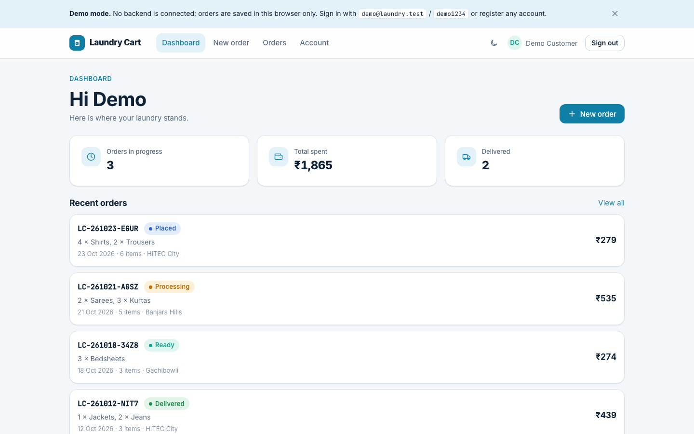

# Laundry Cart

Order-management app for a doorstep laundry service: a four-step garment and wash-type order wizard with live pricing, order history with filters and pagination, and a status timeline from placed to delivered.

**Live demo:** https://avinash9694.github.io/Laundry-cart-frontend/ — runs in demo mode, no backend needed. Sign in with `demo@laundry.test` / `demo1234` or register any account.
**Backend:** https://github.com/Avinash9694/Laundry-cart-backend



## Why I built this

The original Laundry Cart was a 2023 Create React App project with hard-coded `localhost` fetches and prices trusted from the client. I rebuilt it to the standard I hold at work on a Tauri + React desktop product: TypeScript `strict`, one data-access interface with two adapters so the UI is testable and demoable without infrastructure, a pricing module shared with the API so the preview and the invoice cannot disagree, and loading, empty and error states on every async path.

## Features

- **Order wizard** — pick garments and quantities, choose one or more wash types per garment, set a pickup store and address, review a live price breakdown. Progress indicator lets you jump back to any completed step; state survives a refresh via `sessionStorage`.
- **Live pricing** — unit price is the sum of the selected wash types for that garment; ₹49 delivery, free from ₹499. The same pure module prices the wizard preview, the demo adapter and (in JavaScript) the backend.
- **Orders** — status chips, search within the page, four sort orders, server-side pagination and status filters reflected in the URL.
- **Order detail** — items with per-wash prices, price breakdown, a status timeline, and cancel while the order is still `placed` (confirmation dialog).
- **Dashboard** — orders in progress, total spent, delivered count, recent orders.
- **Auth** — register and sign in with inline validation and server errors surfaced inline; protected routes redirect and return you to where you were.
- **Demo mode** — when `VITE_API_URL` is unset the app runs entirely in the browser: bundled catalog and stores, accounts and orders in `localStorage`, simulated latency, and a seeded order history for the demo account. A dismissible banner says so.
- **Quality of life** — light-first theme with a persisted dark toggle, toasts, skeletons, keyboard-reachable everything, visible focus rings, `aria-live` for async status, responsive from 360px to 1440px+.

## Architecture

```
src/
  api/
    client.ts          ApiClient interface — the only thing the UI talks to
    http-client.ts     HttpApiClient: fetch + bearer token + error envelope → ApiError
    demo-client.ts     DemoApiClient: same interface over localStorage, with latency
    demo-data.ts       catalog + stores, identical to the backend seed
    demo-seed.ts       believable order history for the demo account
    index.ts           picks the adapter from VITE_API_URL
  domain/pricing.ts    pure pricing rules (unit price, delivery fee, totals)
  store/
    wizard-logic.ts    pure step/selection/validation functions
    wizard-store.ts    Zustand store persisted to sessionStorage
    auth-store.ts      session (token + user) persisted to localStorage
  hooks/use-api.ts     TanStack Query hooks over the ApiClient
  lib/                 orders filtering/sorting, formatting, toast store, storage guards
  components/ui/       Button, Card, fields, StatusChip, Stepper, Pagination, dialog, toasts
  components/layout/   AppShell (header, demo banner, footer), route guards
  pages/               landing · auth · dashboard · new-order (4 steps) · orders · account · 404
```

```
            ┌──────────────┐        VITE_API_URL set        ┌──────────────────┐
  UI ─────► │  ApiClient   │ ─────────────────────────────► │  HttpApiClient   │ ──► Laundry Cart API
 (Query)    │  interface   │                                └──────────────────┘
            │              │        VITE_API_URL unset      ┌──────────────────┐
            └──────────────┘ ─────────────────────────────► │  DemoApiClient   │ ──► localStorage
                                                            └──────────────────┘
                     both adapters price orders with domain/pricing.ts
```

Pagination and the status filter are applied by the adapter (server-side against the API); search and sort act on the loaded page.

## Tech stack

Vite 6 · React 18 · TypeScript (strict, `exactOptionalPropertyTypes`) · React Router (HashRouter) · TanStack Query 5 · Zustand 5 · react-hook-form + Zod · CSS Modules with design tokens · Vitest + Testing Library · ESLint flat config (typescript-eslint, react-hooks, jsx-a11y) · Prettier · GitHub Actions → GitHub Pages

## Running locally

```bash
npm install
npm run dev            # demo mode at http://localhost:5173/Laundry-cart-frontend/
```

Against the real API ([Laundry-cart-backend](https://github.com/Avinash9694/Laundry-cart-backend)):

```bash
cp .env.example .env   # set VITE_API_URL=http://localhost:5000/api/v1
npm run dev
```

## Testing

```bash
npm test -- --run      # 50 tests
npm run lint
npm run typecheck
npm run build
```

Covered: the pricing module (single and multiple wash types, per-garment prices, free-delivery threshold, parity with the backend fixture), wizard logic (quantity clamping, wash toggling, step completion, furthest reachable step, payload building) and the persisted store, the demo adapter (auth codes, persistence across instances, pagination, cancel rules, ownership), the HTTP adapter (headers, error envelope, query strings, network failure), orders filtering and sorting, and a render test per page driven through the demo adapter with zero latency — login, register conflicts, route guards, dashboard tiles, status filters and search, cancel flow, both wizard halves, account and 404.

## Deployment

`.github/workflows/deploy.yml` lints, typechecks, tests and builds on every push to `main`, then publishes `dist/` to GitHub Pages. `vite.config.ts` sets `base: '/Laundry-cart-frontend/'` and the app uses `HashRouter` so deep links survive a static host.

## Roadmap / known limitations

- Demo mode is per-browser; clearing site data removes demo accounts and orders.
- Search and sort apply to the current page of results; a server-side search endpoint would make them global.
- No admin UI yet — the API supports status updates, the frontend only consumes them.
- Address book, reorder from a past order and payment are out of scope for this version.

## License

MIT — see [LICENSE](LICENSE).
